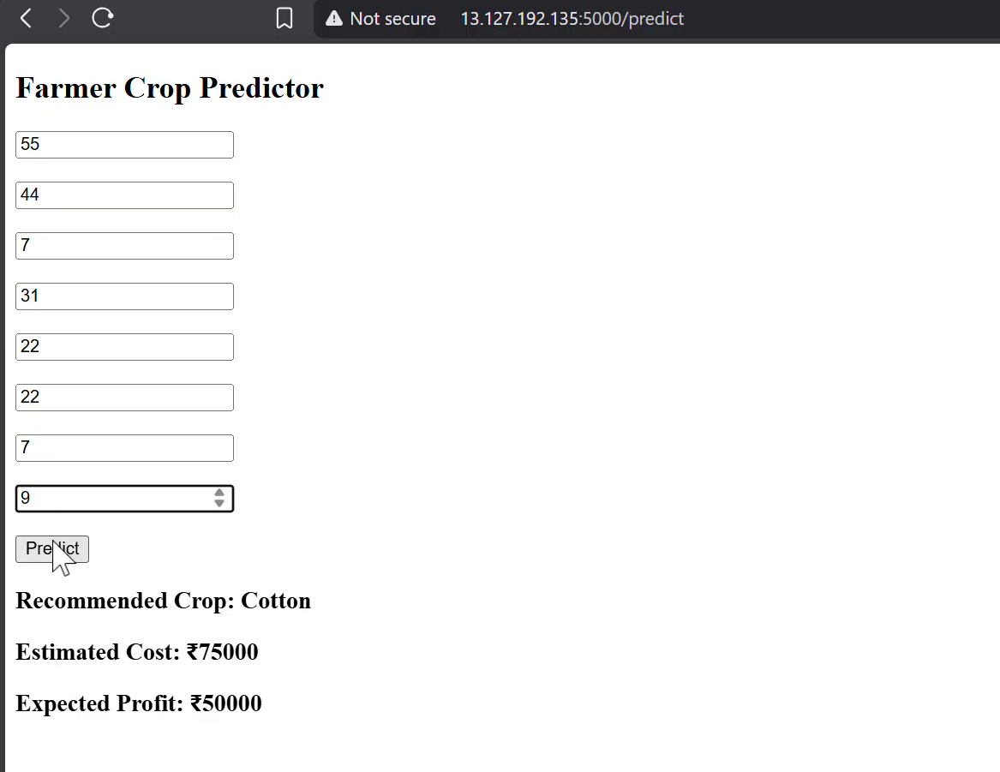

# Crop Prediction

## Project Description

Crop Prediction is a machine learning web application built with Python and Flask that predicts a suitable crop based on agricultural and farming-related input data.

The application uses a Decision Tree Classification model trained on a dataset containing soil nutrients, weather conditions, farming area, and number of workers. Users can enter these values through a web interface to receive a predicted crop along with estimated farming cost and profit.

This project demonstrates Machine Learning, Python Programming, Data Processing, Web Application Development, Model Training, and GitHub Actions (CI).

---

## Tech Stack

* Python
* Flask
* Pandas
* Scikit-learn
* Joblib
* HTML
* CSS
* Machine Learning
* Git
* GitHub
* GitHub Actions (CI)

---

## System Architecture

```text
User
   ↓
Web Interface (HTML & CSS)
   ↓
Flask Web Application
   ↓
User Input Processing
   ↓
Trained Decision Tree Model
   ↓
Predicted Crop
   ↓
Estimated Farming Cost & Profit
   ↓
Results Displayed to User
```

---

## Features

* Crop prediction using machine learning
* Eight agricultural and farming-related input features
* Support for Rice, Wheat, Maize, Cotton, and Millet, along with Sugarcane
* Decision Tree Classification model
* Model training and evaluation using Scikit-learn
* Model persistence using Joblib
* Flask-based web interface
* Estimated farming cost based on the entered area
* Estimated profit based on the entered area
* Automated Python syntax checks using GitHub Actions

---

## Project Workflow

1. The user opens the Crop Prediction web application.
2. The user enters nitrogen, phosphorus, potassium, temperature, humidity, rainfall, farming area, and number of workers.
3. Flask receives the submitted form data.
4. The application converts the input values into numeric features.
5. The trained Decision Tree model predicts a crop.
6. The application calculates estimated farming cost and profit.
7. Flask sends the results back to the web page.
8. The predicted crop and estimates are displayed to the user.

---

## Machine Learning Model

### Algorithm

* Decision Tree Classifier

### Dataset

The model is trained using `crop_data.csv`, which contains agricultural input features and their corresponding crop labels.

### Input Features

| Feature     | Description                      |
| ----------- | -------------------------------- |
| Nitrogen    | Nitrogen value                   |
| Phosphorus  | Phosphorus value                 |
| Potassium   | Potassium value                  |
| Temperature | Temperature value                |
| Humidity    | Humidity value                   |
| Rainfall    | Rainfall value                   |
| Area        | Farming area entered by the user |
| Workers     | Number of workers                |

### Target Variable

The target column is `crop`, which contains the crop label predicted by the model.

The dataset includes six crop categories:

* Rice
* Wheat
* Maize
* Cotton
* Millet
* Sugarcane

### Model Training

The `train.py` script performs the following operations:

1. Loads the dataset using Pandas.
2. Separates input features from the target column.
3. Splits the dataset into training and testing sets using an 80:20 ratio.
4. Trains a Decision Tree Classifier.
5. Evaluates the model using accuracy score.
6. Saves the trained model as `model.pkl` using Joblib.

The model uses a fixed random state of `42` to make the train-test split and classifier setup reproducible.

### Model Evaluation

The model prints its test-set accuracy during training. The actual accuracy depends on the dataset and train-test split.

Because the current dataset contains only 24 rows, the evaluation result should be treated as an initial demonstration rather than evidence of reliable real-world prediction performance.

---

## Cost and Profit Estimation

The application calculates two estimates using the farming area entered by the user.

### Estimated Farming Cost

```python
cost = int(area * 15000)
```

### Estimated Profit

```python
profit = int(area * 10000)
```

These are fixed formula-based estimates implemented in `app.py`. They are not predictions generated by the machine learning model and should not be interpreted as actual financial forecasts.

---

## Project Structure

```text
crop-prediction/
│
├── .github/
│   └── workflows/
│       └── ci.yml
│
├── static/
│   └── style.css
│
├── templates/
│   └── index.html
│
├── app.py
├── train.py
├── crop_data.csv
├── model.pkl
├── requirements.txt
├── .gitignore
└── README.md
```

The `model.pkl` file is generated by running `train.py`. The structure above represents the intended project layout; keep only the files that actually exist in your repository.

---

## Screenshots

### Application Interface



---

## Setup Instructions

### 1. Clone the Repository

```bash
git clone YOUR_REPOSITORY_URL
cd crop-prediction
```

Replace `YOUR_REPOSITORY_URL` with the actual GitHub repository URL.

### 2. Create a Virtual Environment

```bash
python -m venv .venv
```

### 3. Activate the Virtual Environment

For Windows PowerShell:

```powershell
.\.venv\Scripts\Activate.ps1
```

### 4. Install Dependencies

```bash
pip install -r requirements.txt
```

### 5. Train the Model

```bash
python train.py
```

This trains the Decision Tree model, prints its accuracy, and saves the model as `model.pkl`.

### 6. Run the Application

```bash
python app.py
```

Open the local address shown by Flask in your browser. By default, this application is configured to use port `5000`.

---

## GitHub Actions CI

This project uses GitHub Actions for Continuous Integration (CI).

The workflow runs automatically when code is pushed or a pull request is opened.

### Automated Checks

* Install Python dependencies from `requirements.txt`.
* Check Python syntax in `app.py` and `train.py`.

The workflow helps detect basic Python syntax errors and dependency installation issues before changes are integrated.

---

## Skills Demonstrated

* Python Programming
* Machine Learning Fundamentals
* Decision Tree Classification
* Data Processing with Pandas
* Model Evaluation using Accuracy Score
* Model Persistence with Joblib
* Flask Web Application Development
* HTML and CSS
* Git and GitHub
* GitHub Actions
* Continuous Integration (CI)

---

## Future Improvements

* Expand the dataset with more representative agricultural records.
* Evaluate the model using additional metrics and cross-validation.
* Add input validation and user-friendly error handling.
* Improve prediction reliability using more representative training data.
* Replace fixed cost and profit formulas with realistic, data-supported estimates.
* Add automated unit and integration tests.
* Deploy the application to a cloud platform.

---

## Author

**Tanbir Hussain**

GitHub:
https://github.com/tanbir-hsain

LinkedIn:
https://www.linkedin.com/in/tanbir-hussain-76320b414
